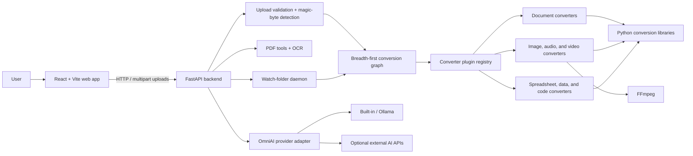

<div align="center">
  
  <h1>OmniConverter</h1>
  <p><strong>A self-hosted workspace for file conversion, PDF tools, and AI assistance.</strong></p>

  <p>
    <a href="https://github.com/Winter-Cream/OmniConverter/actions/workflows/ci.yml"></a>
    <a href="https://github.com/Winter-Cream/OmniConverter/blob/main/LICENSE"></a>
    <a href="https://github.com/Winter-Cream/OmniConverter/stargazers"></a>
    <a href="https://github.com/Winter-Cream/OmniConverter/commits/main"></a>
    <a href="https://github.com/Winter-Cream/OmniConverter/issues"></a>
    
    
  </p>

  <p>
    <a href="#get-started">Get started</a> ·
    <a href="#supported-formats">Formats</a> ·
    <a href="#api-reference">API</a> ·
    <a href="https://github.com/Winter-Cream/OmniConverter/issues">Issues</a>
  </p>
</div>

---

## What is OmniConverter?

OmniConverter is a web app that runs on your own machine. Its React interface sends conversion jobs to a Python/FastAPI server, which processes files locally using format-specific libraries and tools. It currently advertises **47 input extensions** across documents, presentations, images, media, data, and code.

Use the browser queue for single or batch conversions, inspect available output formats, preview many converted results, or use the API and watch-folder automation for repeat tasks.

> Conversion files stay on the machine running the OmniConverter server. If you connect OmniAI to a cloud provider, prompts sent to that provider leave your machine. Provider credentials are stored in browser local storage.

## Demo

<div align="center">
  <table>
    <tr><td align="center" width="760">
      <strong>OmniConverter in action</strong><br><br>
      🎬 Demo recording coming soon — replace this panel with <code>docs/demo.gif</code> when available.
    </td></tr>
  </table>
</div>

## Features

- **Convert files:** Upload, drag and drop, or paste supported files. The interface lists output formats available for each input.
- **Work in batches:** Track per-file conversion status, compare input and output sizes, preview supported outputs, and package successful results into a ZIP.
- **Preview results:** Compare images, play audio and video, inspect PDFs, and view CSV, TSV, and JSON results as tables. XLSX table previews are generated through the conversion API.
- **Adjust output:** Set image quality, video resolution, audio bitrate, resizing, and best-effort target-size presets for supported formats.
- **Protect metadata:** Inspect common PDF and image metadata, then choose to strip metadata from the converted output.
- **Use PDF tools:** Merge, split, compress, protect, unlock, rotate, and OCR supported PDFs.
- **Automate a folder:** Watch an input folder and convert incoming files to a separate output folder. Successfully converted source files are removed from the input folder.
- **Ask OmniAI:** Use built-in guidance, a local Ollama server, or configured OpenAI, Gemini, Anthropic, xAI, OpenRouter, or custom OpenAI-compatible APIs.
- **Convert units:** Use the built-in unit conversion tab for common measurement categories.

## Supported formats

These are the input extensions currently advertised by `/api/formats`. Available output formats depend on the input file and are listed in the app and API response.

| Category | Input extensions |
| --- | --- |
| Documents | `.pdf`, `.docx`, `.txt`, `.html`, `.htm`, `.md` |
| Presentations | `.pptx` |
| Images | `.png`, `.jpg`, `.jpeg`, `.webp`, `.gif`, `.bmp`, `.tiff`, `.ico`, `.svg` |
| Audio* | `.mp3`, `.wav`, `.ogg`, `.flac`, `.aac`, `.m4a`, `.opus` |
| Video* | `.mp4`, `.webm`, `.mkv`, `.avi`, `.mov`, `.flv`, `.wmv`, `.m4v` |
| Data and spreadsheets | `.csv`, `.tsv`, `.xlsx`, `.json`, `.xml`, `.yaml`, `.yml` |
| Code and text | `.py`, `.js`, `.ts`, `.sql`, `.java`, `.c`, `.cpp`, `.rs`, `.go` |

**Format limits:** Not every input converts to every output. Legacy Excel `.xls` is not supported. Conversions from spreadsheets to a single-table format use the first worksheet. PPTX-to-PDF recreates slide content and may change layout. Target-size presets aim for the chosen size; source content, codec, and format limits mean the result is not guaranteed to fit.

\* Audio and video conversion uses the FFmpeg binary bundled by the `imageio-ffmpeg` Python dependency. A system FFmpeg on `PATH` is used when available; `/api/health` reports whether an executable was detected.

## Architecture



The browser handles interaction, queue state, and previews. The backend checks the upload, identifies recognizable binary formats from file contents, and routes conversions through the shortest available conversion path. Converter implementations use Python libraries; FFmpeg handles supported audio and video work. The watch-folder daemon uses the same conversion engine.

## Get started

### Requirements

- Python **3.10 or newer**
- Node.js **22** and npm to build the web interface
- FFmpeg is installed through the Python requirements for audio and video conversion; a system FFmpeg is optional

There are currently no published standalone release binaries or package-manager installers. The source launchers are the supported way to run OmniConverter locally.

### Windows

Open PowerShell in the repository folder and run:

```powershell
./run.bat
```

The launcher installs Python dependencies, builds the frontend if its production bundle is missing, and starts the server. Open the localhost URL printed in the terminal, normally [http://localhost:8500](http://localhost:8500).

### macOS and Linux

```bash
python3 -m venv .venv
source .venv/bin/activate
python -m pip install --upgrade pip
python -m pip install -r requirements.txt
cd frontend
npm ci
npm run build
cd ..
python server.py
```

Open the localhost URL printed by the server. The `run.sh` launcher is also available; it installs Python requirements, builds the frontend when needed, and starts the server.

### Development mode

For frontend changes, start Vite in one terminal:

```bash
cd frontend
npm ci
npm run dev
```

Start the Python server in another terminal from the repository root. To enable interactive FastAPI docs at `/docs`, set `OMNI_ENV=dev` before starting it:

```bash
# macOS / Linux
OMNI_ENV=dev python server.py
```

```powershell
# Windows PowerShell
$env:OMNI_ENV = "dev"
python server.py
```

## Use the API

The API is served from the same origin as the web app. Interactive OpenAPI documentation is available at `/docs` when the server starts with `OMNI_ENV=dev`.

### Convert one file

`POST /api/convert` accepts `multipart/form-data` with a `file`, a `target_format`, and optional JSON `options`. A successful response is the converted file as a binary download; errors return JSON with a `detail` message.

```bash
curl -X POST http://localhost:8500/api/convert \
  -F "file=@document.docx" \
  -F "target_format=pdf" \
  -o document.pdf
```

### Convert multiple files into a ZIP

`POST /api/convert/zip` (also available as `/api/batch-convert`) accepts repeated `files` fields, one `target_format`, and optional JSON `options`. It returns a ZIP archive; failed items are represented by error text files inside the archive.

```bash
curl -X POST http://localhost:8500/api/convert/zip \
  -F "files=@photo-one.png" \
  -F "files=@photo-two.png" \
  -F "target_format=webp" \
  -o converted-files.zip
```

### Endpoint reference

| Method | Endpoint | Request | Successful response |
| --- | --- | --- | --- |
| `GET` | `/api/health` | — | Server status, version, FFmpeg and watch-daemon status |
| `GET` | `/api/formats` | — | Categories, input extensions, and available output targets |
| `POST` | `/api/metadata/inspect` | Multipart `file` | Detected format and common PDF/image metadata fields |
| `POST` | `/api/convert` | Multipart `file`, `target_format`, optional `options` JSON | Converted file download |
| `POST` | `/api/convert/zip`, `/api/batch-convert` | Multipart repeated `files`, `target_format`, optional `options` JSON | ZIP of converted results and per-file error notes |
| `POST` | `/api/pdf/merge` | Multipart repeated `files`, optional comma-separated `passwords` | Merged PDF |
| `POST` | `/api/pdf/split` | Multipart `file`; `page_range`, `mode`, optional `password` | PDF or ZIP, depending on `mode` |
| `POST` | `/api/pdf/compress` | Multipart `file`; optional `level`, `password` | Compressed PDF |
| `POST` | `/api/pdf/protect`, `/api/pdf/unlock` | Multipart `file` and `password` | Protected or unlocked PDF |
| `POST` | `/api/pdf/rotate` | Multipart `file`; `angle`, `page_range`, optional `password` | Rotated PDF |
| `POST` | `/api/pdf/ocr`, `/api/ocr` | Multipart `file`; optional `page_range`, `force_ocr`, `format`, `password` | OCR JSON or downloadable text |
| `POST` | `/api/watch-folder/config` | Form fields `enabled`, `path`, `output_path`, `target_format` | Updated watch-folder configuration JSON |
| `POST` | `/api/ai/chat` | JSON `message`, `provider`, optional key/model/endpoint/history/mode | JSON reply and provider/model information |
| `POST` | `/api/ai/tts` | Form fields `text`, optional `voice` | WAV audio |
| `GET` | `/api/stats` | — | Usage and conversion history JSON |
| `DELETE` | `/api/history`, `/api/history/{index}` | — | History clear/removal status |
| `POST` | `/api/stats/reset` | — | Reset statistics JSON |

All upload endpoints return a JSON error response with `detail` when a request is rejected or conversion fails. Single-file and batch conversion uploads are limited to 200 MB per file; batches allow up to 50 files.

## OmniAI providers and privacy

Built-in OmniAI answers require no credentials. Ollama requires a running local server and an installed model. OpenAI, Gemini, Anthropic, xAI, OpenRouter, and custom OpenAI-compatible endpoints require provider credentials and a valid model. The AI settings save credentials in browser local storage. Prompts sent to external providers are processed under those providers' terms and privacy policies.

File conversion and metadata inspection run on the machine hosting the FastAPI server. Watch-folder paths must be accessible to that machine, and its output folder must not be the same as or nested inside the input folder.

## Development checks

```bash
python -m pip install -r requirements.txt
python -m pytest -q
python -m flake8 server.py converter_engine.py conversion_architecture.py watch_daemon.py tests --select=E9,F63,F7,F82
cd frontend
npm ci
npm run lint
npm run build
```

GitHub Actions runs the backend checks on Windows, macOS, and Ubuntu, and runs frontend lint and build checks on Ubuntu for pushes and pull requests to `main` and `develop`.

## Contributing

Bug reports, reproducible conversion samples, and focused pull requests are welcome. Please include the input/output formats, operating system, and relevant error text. Run the checks above before submitting changes.

## Roadmap

- [ ] Add a short demo recording and screenshots.
- [ ] Publish signed standalone builds.
- [ ] Expand automated coverage for conversion paths and format fidelity.

## License

OmniConverter is licensed under the [MIT License](LICENSE).

<div align="center"><sub>Convert and manage files from your own workspace.</sub></div>
